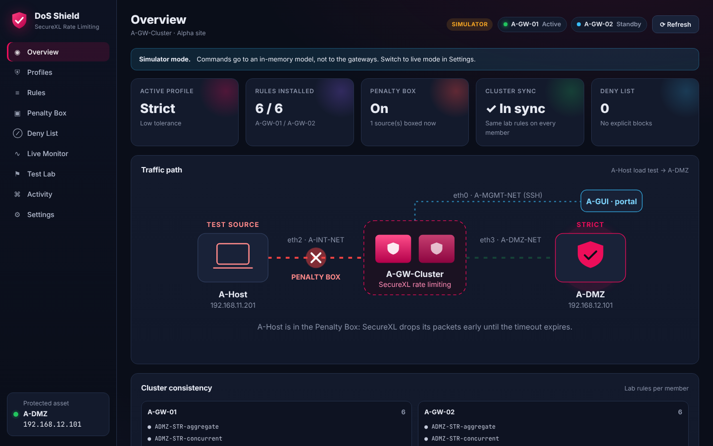
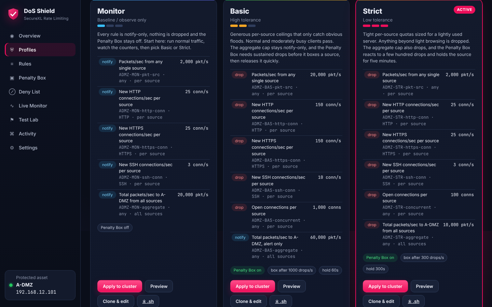
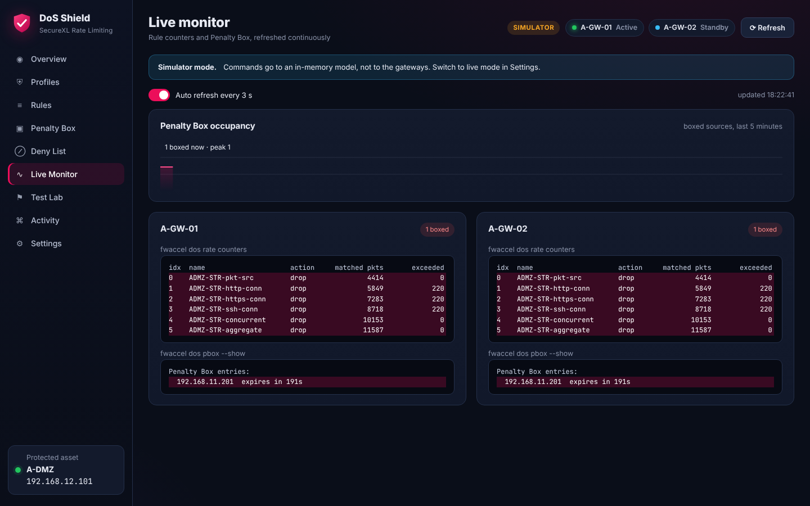
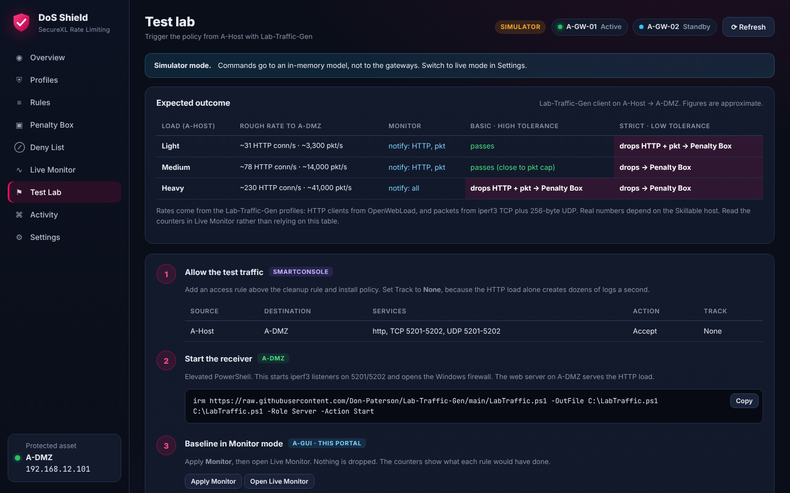

# SecureXL-Rate-limiting

SecureXL DoS rate limiting for the CCSA R82 Alpha lab. The goal is to protect
**A-DMZ (192.168.12.101)** from floods and connection storms from any source,
on both members of **A-GW-Cluster**. It has four parts:

- **Three preset profiles:** Monitor, Basic (high tolerance) and Strict (low
  tolerance). You can also build your own custom profiles.
- **DoS Shield portal:** a Python web portal on A-GUI. It shows the live
  configuration of both cluster members and lets you apply, change or add
  rules, Penalty Box settings and deny entries.
- **One-line deployment** onto A-GUI with `irm | iex`.
- **A test plan** that uses [Lab-Traffic-Gen](https://github.com/Don-Paterson/Lab-Traffic-Gen)
  on A-Host to drive traffic from inside the network into the limits and the
  Penalty Box.



---

## Quick start

### 1. Deploy the portal on A-GUI (10.1.1.201)

PowerShell, no admin rights needed:

```powershell
irm https://raw.githubusercontent.com/Don-Paterson/SecureXL-Rate-limiting/main/Deploy.ps1 | iex
```

The script:

1. Downloads this repo to `C:\SecureXL-RL`.
2. Installs Python 3.12 for the current user if no Python is found.
3. Builds a virtual environment with Flask and Paramiko.
4. Asks once for the gateway SSH user and password.
5. Checks SSH to 10.1.1.2 and 10.1.1.3.
6. Adds a **SecureXL DoS Shield** desktop shortcut and opens
   `http://127.0.0.1:8088`.

Re-running it updates the code and keeps `data\` (settings and custom profiles).

Optional, set before the `irm` line:

| Variable | Default | Purpose |
|---|---|---|
| `$env:SXL_PATH` | `C:\SecureXL-RL` | Install folder |
| `$env:SXL_BRANCH` | `main` | Branch to deploy |
| `$env:SXL_PORT` | `8088` | Portal port |
| `$env:SXL_SIMULATOR` | — | `1` = start with simulated gateways, to explore without a lab |

### 2. Gateway prerequisite

The portal runs `fwaccel dos …` over SSH, so the SSH user's login shell must
be bash. On each member, in clish:

```
set user admin shell /bin/bash
save config
```

If a member still answers in clish, the portal detects the `CLINFR0329
Invalid command` reply and shows a **Switch to bash** button. That button
sends those two clish commands over SSH, reconnects and checks that bash
answers. To undo it later from Expert mode:
`clish -c "set user admin shell /etc/cli.sh" && clish -c "save config"`.

### 3. Pick a profile

Open **Profiles** and apply **Monitor** first. Run normal traffic and watch
**Live Monitor**, then move to **Basic** or **Strict**.

---

## The profiles

Every rule matches destination `192.168.12.101/32` from **any source**.
`track source` turns each limit into a per-source quota, so every client gets
its own budget. That covers an internal client such as A-Host as well as
external sources. Lab rules are named `ADMZ-…`. Applying a profile removes
only rules with that prefix, on both members, before installing the new set.

| Rule | Monitor | Basic · high tolerance | Strict · low tolerance |
|---|---|---|---|
| Packets/s per source | 2,000 *notify* | 20,000 drop | 2,000 drop |
| New HTTP conn/s per source (6/80) | 25 *notify* | 150 drop | 25 drop |
| New HTTPS conn/s per source (6/443) | 25 *notify* | 150 drop | 25 drop |
| New SSH conn/s per source (6/22) | 3 *notify* | 10 drop | 3 drop |
| Concurrent conns per source | — | 1,000 drop | 100 drop |
| Aggregate packets/s to A-DMZ (all sources) | 20,000 *notify* | 60,000 *notify* | 10,000 drop |
| Penalty Box | off | on · 1,000 drops/s · 60 s | on · 300 drops/s · 300 s |
| Penalty Box drop logging | on | on | on |

- **Monitor** follows the lab guide's monitor-first advice. Nothing is
  dropped, and the counters show what each rule would have done.
- **Basic** is for a busy, public-facing server where false positives cost
  more than a short flood. Only obvious abuse is dropped. The destination-wide
  cap stays notify-only, as the lab guide recommends until peak traffic has
  been measured. A boxed source is released after a minute.
- **Strict** is for a lightly used server where any burst is suspicious.
  Tight per-source budgets, an enforced aggregate cap, a Penalty Box that
  reacts quickly and a five-minute hold.

These thresholds are lab starting points sized against the Lab-Traffic-Gen
profiles, not production values.



### Custom profiles

**Clone & edit** on any preset, or **Create custom profile**, opens an editor
with name, action, source, service, limit, value and track per rule, plus the
Penalty Box settings. Custom profiles are saved in
`data\custom_profiles.json` and applied the same way as the presets.

### Without the portal

`gateway/` has the same profiles as standalone scripts for Expert mode. Run
them on **each** member:

```bash
bash admz-status.sh                # read-only baseline, keep the output
bash admz-strict.sh --dry-run      # print the commands only
bash admz-strict.sh                # remove ADMZ-* rules, install Strict
bash admz-cleanup.sh               # remove ADMZ-* rules, Penalty Box off
```

Every profile in the portal also has a **⤓ .sh** button that generates the
same kind of script. From the repo:
`python portal/app.py --export basic > admz-basic.sh`.

---

## The portal

| Tab | What it does |
|---|---|
| **Overview** | Active profile, rule counts, Penalty Box and deny-list state, live traffic-path diagram, and a per-member comparison that flags drift between A-GW-01 and A-GW-02 |
| **Profiles** | Preview the exact commands, apply to the cluster, clone and edit, export as a script |
| **Rules** | Parsed `fwaccel dos rate get` per member with raw output. Add a single rule to both members. Delete by UID on one member, or by name across the cluster |
| **Penalty Box** | Enable, drops threshold, timeout and log drops, applied to both members. Shows the sources currently boxed |
| **Deny List** | Add or remove explicit blocks (lost on reboot) |
| **Live Monitor** | Rate counters and Penalty Box contents for each member every 3 s, with changed lines highlighted and a chart of how many sources are boxed |
| **Test Lab** | The A-Host test procedure below, with copy buttons and an expected-outcome table |
| **Activity** | Every command sent, with exit code and output, plus one-click read-only diagnostics (`cphaprob state`, `fwaccel stats -s`, `fwaccel dos config get` …) |
| **Settings** | Member IPs, SSH credentials, protected IP, lab prefix, simulator mode and the **command templates** |



**Safety:**

- The portal binds to `127.0.0.1` only.
- Every value sent to a gateway is validated and shell-quoted, and there is
  no free-text command box.
- Bulk removal only touches rules named with the lab prefix.
- Rules from anything else need an explicit per-rule delete, with a warning.

**Command templates:** `fwaccel dos` syntax can vary between R82 builds and
Jumbo Hotfixes. If the gateway rejects a command, compare it with
`fwaccel dos rate -h` (or `pbox -h`, `deny -h`) and adjust the template under
**Settings → Command syntax**. No code change is needed. The defaults follow
the lab guide:

```
fwaccel dos rate add -a {d|n} -n <name> [source cidr:…] destination cidr:192.168.12.101/32 [service P/N] <limit> <value> [track source]
fwaccel dos rate del <uid>
fwaccel dos pbox --set-drops-threshold N | --set-timeout N | --set-log-drops on|off | --set-enabled on|off
fwaccel dos deny --add IP | --delete IP | --show
```

**Simulator:** `python portal/app.py --simulator` (or the Settings toggle)
swaps SSH for an in-memory model of the rate policy, Penalty Box and deny
list. Use it to try the portal before the lab is up.

---

## Triggering the policy from A-Host

A-Host (192.168.11.201) plays a misbehaving internal client. The existing
Lab-Traffic-Gen tool already generates both kinds of load that these rules
measure:

- **Connection rate:** OpenWebLoad HTTP to A-DMZ.
- **Packet rate:** iperf3 TCP plus 256-byte UDP.

So the test uses it unchanged, with A-DMZ as the receiver.

1. **SmartConsole:** add *A-Host → A-DMZ, services http, TCP 5201-5202 and
   UDP 5201-5202, Accept, Track None*, then install policy.
2. **A-DMZ:** start the receiver:
   ```powershell
   irm https://raw.githubusercontent.com/Don-Paterson/Lab-Traffic-Gen/main/LabTraffic.ps1 -OutFile C:\LabTraffic.ps1
   C:\LabTraffic.ps1 -Role Server -Action Start
   ```
3. **Portal:** apply **Monitor** and open **Live Monitor**.
4. **A-Host:** generate load and step it up:
   ```powershell
   irm https://raw.githubusercontent.com/Don-Paterson/Lab-Traffic-Gen/main/LabTraffic.ps1 -OutFile C:\LabTraffic.ps1
   C:\LabTraffic.ps1 -Role Client -Action Start -Load Light -Target 192.168.12.101 -Duration 300
   C:\LabTraffic.ps1 -Action Stop
   C:\LabTraffic.ps1 -Role Client -Action Start -Load Heavy -Target 192.168.12.101 -Duration 300
   ```
5. **Portal:** apply **Basic**, then **Strict**, repeating step 4 each time.
6. **Failover:** `clusterXL_admin down` on the active member, re-run the load,
   check the Overview sync panel, then `clusterXL_admin up`.
7. **Clean up:** `C:\LabTraffic.ps1 -Action Stop` on A-Host, then **Remove lab
   rules** and switch the Penalty Box off in the portal.

### Expected outcome (approximate)

| Load from A-Host | Rough rate to A-DMZ | Monitor | Basic | Strict |
|---|---|---|---|---|
| Light | ~31 HTTP conn/s · ~3,300 pkt/s | notify | passes | drops → **Penalty Box** |
| Medium | ~78 HTTP conn/s · ~14,000 pkt/s | notify | passes (close to the 20k pkt cap) | drops → **Penalty Box** |
| Heavy | ~230 HTTP conn/s · ~41,000 pkt/s | notify | drops → **Penalty Box** | drops → **Penalty Box** |

The rates come from Lab-Traffic-Gen's profiles, and Skillable hosts vary, so
trust the counters over this table.

Once A-Host is boxed, SecureXL drops **all** its traffic through the gateway
until the timeout expires. That includes an RDP session to A-Host that
crosses the gateway, so use the lab console.



### If nothing triggers

- **Counters at zero:** confirm which member is active (`cphaprob state`) and
  that the traffic is accelerated (`fwaccel stats -s`).
- **Rate limiting or the Penalty Box ignores A-Host:** these can be limited
  to external interfaces, and A-Host sits behind eth2 (internal). Check
  `fwaccel dos config get` for the internal-interfaces setting on your build.
- **A command was rejected:** adjust the template in Settings, as described
  above.

---

## Command reference

A line-by-line explanation of every command the portal and scripts send covers:

- the Basic rate rules;
- the Penalty Box settings;
- monitoring;
- cleanup.

It is available in three formats:

- [docs/COMMAND-REFERENCE.md](docs/COMMAND-REFERENCE.md), to read on GitHub
- [docs/COMMAND-REFERENCE.docx](docs/COMMAND-REFERENCE.docx), Word, for handouts
- [docs/COMMAND-REFERENCE.xlsx](docs/COMMAND-REFERENCE.xlsx), Excel, filterable by category, plus a
  rule-anatomy sheet and a Monitor / Basic / Strict comparison

## Persistence and ClusterXL

- **Run everything on both members.** The portal does this for you and
  flags drift. The standalone scripts must be run on each member.
- **Rate-limit rules** generally survive a reboot.
- **Penalty Box settings and CLI deny entries may not survive a reboot.**
  Re-apply the profile after a reboot and verify with
  `fwaccel dos pbox --show-config`. For a permanent deny entry, use the files
  in `$FWDIR/conf/deny_lists/` with `fwaccel dos deny --load-default`.
- Don't use blanket flush or delete-all commands on a shared gateway. The
  portal and scripts only ever remove `ADMZ-*` rules.

## Repo layout

```
Deploy.ps1                 irm | iex installer for A-GUI
requirements.txt           flask, paramiko
portal/app.py              Flask app and REST API (python app.py [--simulator] [--export ID])
portal/gateway.py          SSH transport, command builder, validation, output parsers, simulator
portal/profiles.json       Monitor / Basic / Strict presets
portal/templates, static   UI
gateway/*.sh               standalone Expert-mode scripts (status, profiles, cleanup)
data/                      settings.json and custom_profiles.json (created at runtime, git-ignored)
```

## References

- Check Point R82 Performance Tuning Administration Guide: SecureXL
  `fwaccel dos rate`, `pbox`, `deny`
- Check Point R82 SecureXL DoS Rate Limiting, ClusterXL lab guide (the
  staged monitor → enforce → Penalty Box approach used here)
- [Lab-Traffic-Gen](https://github.com/Don-Paterson/Lab-Traffic-Gen)

Lab use only. Validate every command against the installed R82 build and
Jumbo Hotfix before relying on it.
